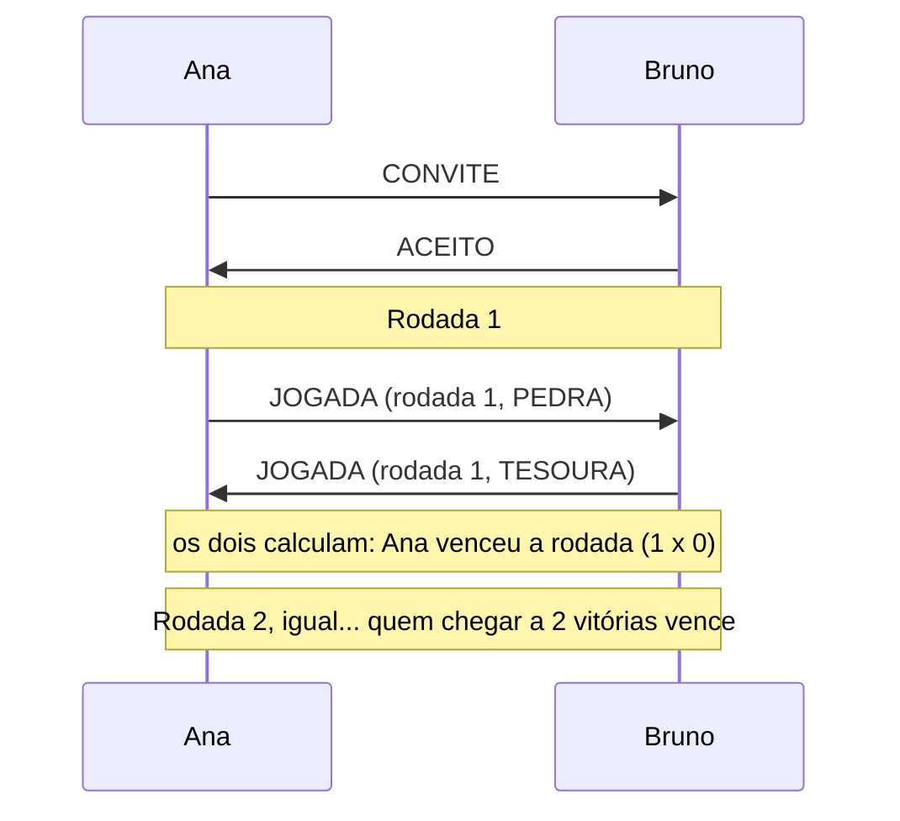
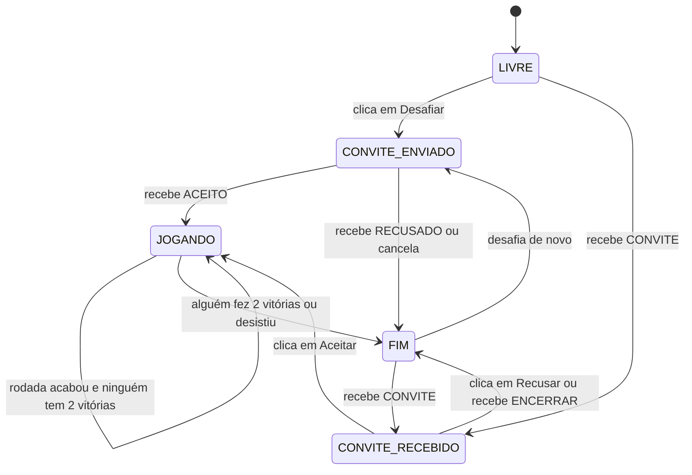

# Jokenpô: plugin de pedra, papel e tesoura para o Pitiupi

Este plugin deixa duas pessoas da mesma sala do Pitiupi jogarem pedra, papel e tesoura pela rede, numa partida melhor de 3. É um plugin de comunicação individual: as mensagens são trocadas só entre os dois jogadores.

Todo o código está na pasta `plugins/jokenpo`. Fora dela, só acrescentei a entrada do Jokenpô no `plugins.registry.json`; não mudei nada no núcleo nem nos outros plugins.

## Como usar

1. Abra o **Jokenpô** na aba **Plugins** (ou clique no nome de alguém na lista lateral e escolha **Desafiar para Jokenpô**).
2. Escolha o adversário e clique em **Desafiar**.
3. Do outro lado, a aba do Jokenpô abre sozinha com os botões **Aceitar** e **Recusar**.
4. Em cada rodada, cada um clica em **Pedra**, **Papel** ou **Tesoura**. Quem ganhar 2 rodadas vence. Empate não conta.
5. **Desistir** encerra a partida e o outro vence por W.O. Enquanto o convite não foi respondido, o mesmo botão vira **Cancelar convite**.

Embaixo fica o **Log do protocolo**, que mostra cada mensagem enviada (`->`) e recebida (`<-`). Ajuda a ver o protocolo funcionando.

Os dois precisam estar na **mesma porta** no login e com a **mesma versão** do plugin.

## Como compilar e rodar

Precisa de Java 17 ou mais novo e do Ant. O plugin já está no catálogo (`plugins.registry.json`, id `jokenpo`, categoria Jogos), então basta rodar na raiz do projeto:

```bash
./scripts/pitiupi.sh run --all     # Linux / WSL
scripts\pitiupi.cmd run --all      # Windows
```

O script compila o núcleo e todos os plugins do catálogo, incluindo o Jokenpô, copia os JARs para `.pitiupi/plugins` e abre o Pitiupi.

Para compilar só o plugin: `cd plugins/jokenpo && ant clean jar`, que gera `dist/pitiupi.jokenpo.jar` (o núcleo precisa ter sido compilado antes).

Para testar pela rede, use **dois computadores** na mesma rede e na mesma porta. Duas janelas no mesmo computador normalmente não se enxergam (veja `docs/usar.md`).

Os testes automáticos rodam com `ant test` dentro de `plugins/jokenpo` (precisa do JUnit em `pitiupi/test/lib`).

---

## Protocolo

### Como as mensagens viajam

O plugin não abre socket nenhum. Ele monta uma mensagem e pede para o núcleo enviar:

```java
MessageDispatcher.send(conexao, mensagem, SendTarget.broadcastAll(), TransportMode.MULTICAST_UDP);
```

Escolhi **UDP multicast** porque é o mesmo caminho que o núcleo usa para o heartbeat (o aviso de "estou online"). Então, se o adversário aparece na lista de usuários, a mensagem chega até ele. O grupo multicast é o `224.0.0.3`, na porta escolhida no login.

Como o multicast entrega para a sala inteira, toda mensagem leva no campo `para` o id de quem deve recebê-la. Quem recebe uma mensagem que não é para ele simplesmente ignora. Esse id é o mesmo `instanceId` que o núcleo usa no heartbeat.

O núcleo transforma a mensagem em bytes com a serialização do próprio Java (a classe `Message` é `Serializable`). Por isso os dois lados precisam ter a mesma versão da classe.

### A mensagem

Existe uma única classe, `JokenpoMensagem`. O campo `tipo` diz o que ela significa.

| Campo | O que guarda |
| --- | --- |
| `tipo` | `CONVITE`, `ACEITO`, `RECUSADO`, `JOGADA` ou `ENCERRAR` |
| `partidaId` | Um UUID criado por quem convida. Identifica a partida. |
| `de` / `deNome` | Id e nome de quem enviou |
| `para` | Id de quem deve receber |
| `rodada` | Número da rodada (só na `JOGADA`) |
| `jogada` | `PEDRA`, `PAPEL` ou `TESOURA` (só na `JOGADA`) |
| `texto` | O motivo (só no `RECUSADO` e no `ENCERRAR`) |

### Tipos de mensagem

| Tipo | Quem manda | Quando |
| --- | --- | --- |
| `CONVITE` | quem desafia | clicou em Desafiar |
| `ACEITO` | o convidado | clicou em Aceitar |
| `RECUSADO` | o convidado | clicou em Recusar, ou já estava jogando com outra pessoa (aí a recusa é automática) |
| `JOGADA` | os dois | escolheu pedra, papel ou tesoura na rodada |
| `ENCERRAR` | qualquer um | desistiu da partida ou cancelou o convite |

### Uma partida passo a passo

1. Ana clica em Desafiar e manda um `CONVITE` para Bruno.
2. Bruno aceita e responde com `ACEITO`. Os dois entram na rodada 1.
3. Cada um escolhe sua jogada e manda uma `JOGADA` com o número da rodada.
4. Quando um jogador tem a sua jogada e a do outro, ele calcula quem ganhou a rodada. Os dois fazem essa conta sozinhos e chegam no mesmo resultado.
5. Se ninguém chegou a 2 vitórias, começa a próxima rodada. Senão, a partida acaba.



A ordem das duas jogadas não importa: quem jogar primeiro só espera a do outro chegar.

### Estados de cada jogador



### Regras que cada jogador segue

- Ignoro mensagem que não tem o meu id no `para`.
- Ignoro mensagem de outra partida (`partidaId` diferente da minha) ou de outra rodada.
- Se recebo um convite enquanto já estou numa partida, respondo `RECUSADO` automaticamente e continuo a partida atual.
- Se a jogada do adversário chega antes de eu jogar, guardo ela mas **não mostro na tela** qual foi. A tela só diz "Bruno já jogou", senão eu poderia escolher a jogada que ganha. As duas jogadas só aparecem juntas no resultado da rodada.

### Limitações

- **Perda de pacotes:** UDP não garante entrega e o plugin não reenvia nada. Numa rede local isso é raro, mas se uma mensagem se perder a partida trava e é preciso clicar em **Desistir**. Uma melhoria seria reenviar a última mensagem a cada segundo até receber resposta.
- **Adversário que sai:** se o outro fechar o programa no meio da partida, o plugin não percebe sozinho. É só clicar em **Desistir**.
- **Confiança na tela:** a jogada do adversário pode chegar antes de eu jogar e só não aparece porque a tela esconde. Uma versão modificada do plugin poderia olhar. Para resolver isso daria para usar *commit-reveal*: cada um manda primeiro só um hash da jogada e só depois revela a jogada.
- **Sem segurança:** as mensagens não são criptografadas e ninguém confere se o `de` é verdadeiro.

---

## Organização do código

| Arquivo | O que faz |
| --- | --- |
| `logica/Jogada.java` | As três jogadas e quem ganha de quem |
| `logica/JokenpoControle.java` | Estados e regras do protocolo. Não usa Swing nem rede, por isso dá para testar sozinho |
| `rede/JokenpoMensagem.java` | A mensagem do protocolo |
| `tela/JokenpoPainel.java` | A tela: botões, placar e log |
| `plugin/JokenpoPlugin.java` | Liga tudo ao núcleo: envia por multicast, recebe e atualiza a lista de usuários |

As mensagens chegam numa thread do núcleo, e o `JokenpoPlugin` passa elas para a thread do Swing com `SwingUtilities.invokeLater`. Assim todo o `JokenpoControle` roda numa thread só e não preciso de `synchronized`.

Os testes (`test/.../JokenpoControleTest.java`) simulam a rede com uma "rede falsa" que entrega cada mensagem para todos os jogadores, como o multicast, e cobrem: as regras do jogo, uma partida completa com empate, um terceiro usuário ignorando a partida dos outros, a jogada do adversário escondida até eu jogar, recusa automática de convite e desistência.
